

<picture><source media="(prefers-color-scheme: dark)" srcset="assets/hero-dark.svg"></picture>

<picture><source media="(prefers-color-scheme: dark)" srcset="assets/social-l-dark.svg"></picture><a href="https://www.instagram.com/rosikur_"><picture><source media="(prefers-color-scheme: dark)" srcset="assets/social-1-dark.svg"></picture></a><a href="https://tiktok.com/@rosi_787_3"><picture><source media="(prefers-color-scheme: dark)" srcset="assets/social-2-dark.svg"></picture></a><a href="https://www.paypal.me/RostomSile"><picture><source media="(prefers-color-scheme: dark)" srcset="assets/social-3-dark.svg"></picture></a><picture><source media="(prefers-color-scheme: dark)" srcset="assets/social-r-dark.svg"></picture>

<picture><source media="(prefers-color-scheme: dark)" srcset="assets/about-dark.svg"></picture>

<picture><source media="(prefers-color-scheme: dark)" srcset="assets/stack-dark.svg"></picture>

<a href="https://github.com/rosikur/mR3"><picture><source media="(prefers-color-scheme: dark)" srcset="assets/project-mr3-dark.svg"></picture></a>&nbsp;<a href="https://github.com/rosikur/keyboard"><picture><source media="(prefers-color-scheme: dark)" srcset="assets/project-keyboard-dark.svg"></picture></a>

<a href="https://github.com/rosikur/Mac-Mini-Ai-Powered-WALL-E"><picture><source media="(prefers-color-scheme: dark)" srcset="assets/project-mac-mini-ai-powered-wall-e-dark.svg"></picture></a>&nbsp;<a href="https://github.com/rosikur/BriefComputer"><picture><source media="(prefers-color-scheme: dark)" srcset="assets/project-briefcomputer-dark.svg"></picture></a>

<picture><source media="(prefers-color-scheme: dark)" srcset="assets/stats-dark.svg"></picture>

<picture><source media="(prefers-color-scheme: dark)" srcset="assets/streak-dark.svg"></picture>

<picture><source media="(prefers-color-scheme: dark)" srcset="assets/wave-dark.svg"></picture>

<a href="https://metawka.github.io/expressive-profile/?from=rosikur"><picture><source media="(prefers-color-scheme: dark)" srcset="assets/credit-dark.svg"></picture></a>

